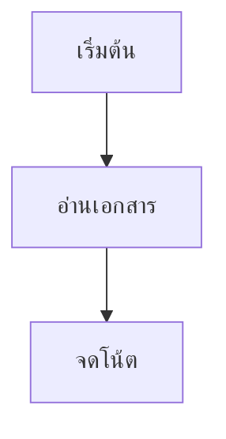

# แผนภาพ Mermaid จาก ChatGPT

NotePocket 0.11 ขึ้นไปเก็บ Mermaid เป็นข้อความในโน้ต พร้อมตัวแสดงแผนภาพออฟไลน์ ไม่ต้องมีบัญชีหรือเชื่อม Drive เพื่อใช้

## วางข้อความทั้งคำตอบ

คัดลอกคำตอบจาก ChatGPT ที่มีกล่อง `mermaid` แล้ววางในโน้ต โดยเก็บเครื่องหมายเปิด/ปิดกล่อง เช่น:

````text

````

แอปจะแสดงการ์ด **แผนภาพ Mermaid** ใต้เนื้อหา กด **ดูแผนภาพ** หากมีหลายกล่องจะให้เลือกแผนภาพที่จะเปิด รองรับการตรวจพบสูงสุด 20 กล่องต่อโน้ต

## คัดลอกเฉพาะโค้ด

เปิดโน้ต → เลื่อนแถบเครื่องมือไปที่ไอคอนผังงาน **แผนภาพ Mermaid** → วางโค้ดในแท็บ **โค้ด** → กด **แผนภาพ** เพื่อดูผล → กด **✓** เพื่อแทรกหรืออัปเดตในโน้ต ปุ่ม **ตัวอย่าง** ใช้ผังการเจริญของพืชสำหรับเริ่มต้น

- โค้ดที่ขึ้นต้นด้วย `flowchart TD` หรือ Mermaid ชนิดอื่นที่รองรับจะเปิดได้แม้ไม่มีเครื่องหมาย ```
- ใช้สองนิ้วซูม ลากเพื่อเลื่อน หรือใช้ปุ่มขยาย/ย่อ/พอดีจอ
- กด **PNG** แล้วเลือกตำแหน่งบันทึก ได้ไฟล์รูปพื้นหลังขาว
- แก้ในแท็บโค้ดแล้วกด ✓ เท่านั้นจึงเปลี่ยนเนื้อหาโน้ต ปุ่มย้อนกลับข้อความในโน้ตคืนการแก้แผนภาพได้
- โค้ดอยู่ใน body ของโน้ต จึงติดไปกับสำรอง ZIP และซิงก์ Drive ตามเดิม ไม่เปลี่ยน schema ฐานข้อมูลหรือรูปแบบสำรอง

## ขอบเขต

ตัวแสดงใช้ Mermaid 10.9.3 รองรับ flowchart, sequenceDiagram, classDiagram, stateDiagram, erDiagram, gantt, pie, mindmap, timeline และชนิดที่มีในรุ่นนี้ โค้ด Python/JavaScript ทั่วไปจะไม่ถูกรันเป็นโปรแกรม และโค้ด Mermaid ที่ใช้ไวยากรณ์รุ่นใหม่กว่าอาจต้องปรับก่อน

จำกัดโค้ด 50,000 ตัวอักษรและ 500 เส้นเชื่อมต่อแผนภาพ ไม่รองรับคำสั่งตั้งค่า `%%{init:...}%%` หรือ YAML frontmatter รุ่นนี้ปิดลิงก์ รูปภาพภายนอก และ HTML ฝังในแผนภาพ ส่งออก PNG ด้านยาวไม่เกิน 3,072 พิกเซลและไม่เกิน 6 ล้านพิกเซล หากโค้ดผิดจะแจ้งให้กลับไปแก้ โดยเก็บต้นฉบับไว้

การสร้าง APK ต้องมี Python 3 และอินเทอร์เน็ตเพื่อดาวน์โหลดแพ็กเกจที่ตรึงรุ่นและตรวจ SHA-512 ผ่าน Gradle task `prepareDiagramRenderer` จากนั้นสคริปต์และใบอนุญาตถูกบรรจุใน APK การแสดงแผนภาพบนมือถือไม่โหลด CDN และตัว WebView ถูกบล็อกการเชื่อมต่อเครือข่าย/ไฟล์เครื่อง
